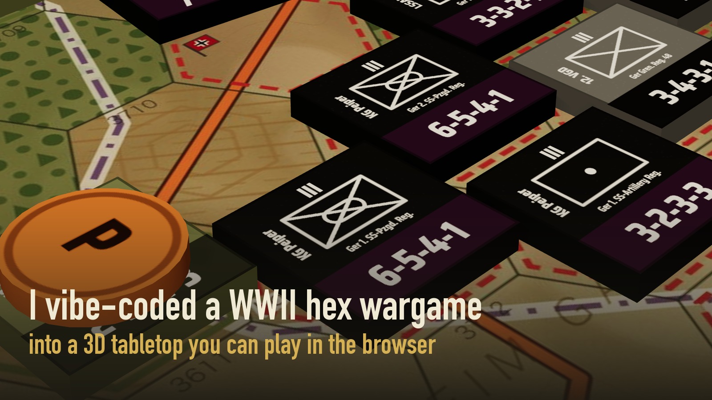
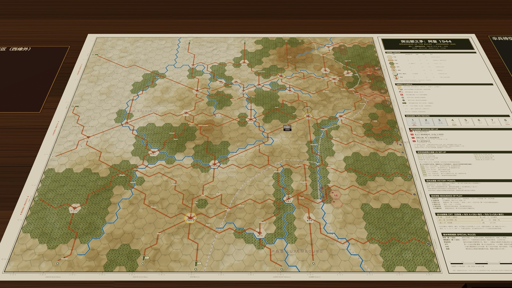
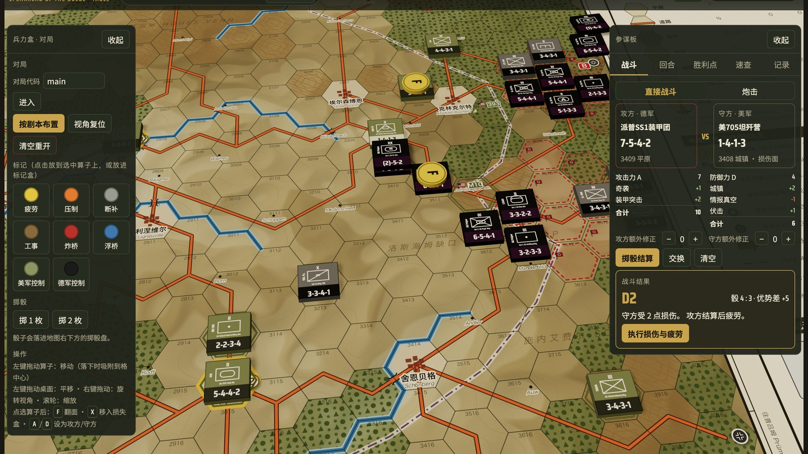
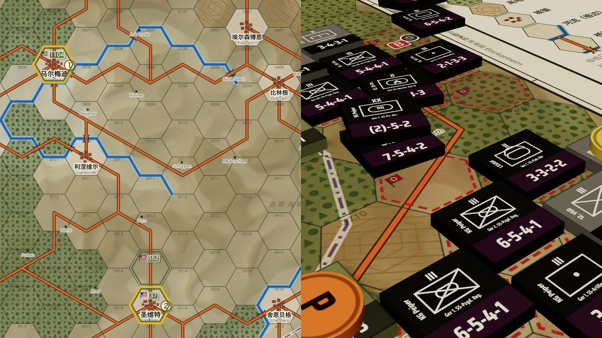

<div align="center">



# 突出部之矛：阿登 1944

**SPEARHEAD OF THE BULGE · ARDENNES 1944**

一盘原创设定的二战六角格兵棋，和一张打开浏览器就能开打的 3D 桌面。

[](https://claude.ai/artifact/NxoErS3xyodDRNKgXfpgy2)


[**在线试玩**](https://claude.ai/artifact/NxoErS3xyodDRNKgXfpgy2) ·
[规则书](<修订版（中文）/突出部之矛：阿登1944 规则书（最终修订版·中文）.pdf>) ·
[战役地图](<修订版（中文）/战役地图（914×610mm）.pdf>) ·
[提 Issue](../../issues)

</div>

---

> 1944 年 12 月，阿登森林。
> 德军装甲矛头冲向默兹河，美军死守巴斯托涅。
> 八个回合，一张 40×31 格的地图，决定这场冬季攻势的走向。

## ✦ 能做什么

| | |
|---|---|
| **六角格地图 + 3D 物理算子** | 算子能拖、能翻面、能叠放，松手自动吸附到格子中心 |
| **开局 / 部署** | 按剧本一键布置 |
| **战斗结算** | 战斗结果表自动查、骰子自动掷，告别翻规则书；桌上的骰子也能直接点着掷 |
| **天气 / 燃油 / 空袭** | 一键掷骰判定 |
| **胜利点** | 自动统计，回合阶段随时提示 |
| **热座双人与在线对战** | 打开浏览器就能玩，不用装 |
| **内置规则书** | 网页里点“规则书”就能翻，也能下载 PDF |

## ✦ 截图

<table>
<tr>
<td width="50%"></td>
<td width="50%"></td>
</tr>
<tr>
<td colspan="2"></td>
</tr>
</table>

## ✦ 快速开始

**在线玩（推荐）**

直接打开：**https://claude.ai/artifact/NxoErS3xyodDRNKgXfpgy2**

不登录也能在本机推演（单人或热座双人）；两人在线对战需要登录 claude.ai。

**本地运行**

```bash
cd web
python3 -m http.server 8000
```

然后打开 http://localhost:8000 。本地运行只有单机 / 热座模式，在线对战依赖 claude.ai 的联机服务。

**打印版**

打印 [规则书 PDF](<修订版（中文）/突出部之矛：阿登1944 规则书（最终修订版·中文）.pdf>) 和 [战役地图 PDF（914×610 mm）](<修订版（中文）/战役地图（914×610mm）.pdf>)，就能在真实桌面上摆开。

## ✦ 游戏一览

| 项目 | 内容 |
|---|---|
| 人数 | 2 人（德军 / 美军） |
| 回合 | 8 回合 |
| 地图 | 40×31 六角格，每格 2.5 公里，比例尺 1:135,000 |
| 地理 | 城镇、河流与 1944 年的公路网按真实经纬度落格，从蒙绍到巴斯托涅 |
| 规则书 | 中文最终修订版；另有原版的简体中文、繁体中文、English、日本語、한국어 版本 |

## ✦ 制作过程

```
 手工古法            AI 沙箱试玩           逐条修订             真实地理             网页 3D 桌面
 算子设计美术   ──▶   千余次对局     ──▶   规则 + 勘误   ──▶   重画战役地图   ──▶   three.js + 物理
```

- **算子与美术**：手工古法设计绘制。
- **规则**：由 Claude Code 严格按条文跑沙箱对局，找出冲突和漏洞，再逐条修订、回到沙箱验证，直到双方胜率接近。修订条文和算子勘误合并成了最终修订版规则书。
- **地图与网页版**：由 Claude Code 完成。

应该没什么村规了吧……大概。发现了欢迎提 issue。

## ✦ 目录结构

```
.
├── web/                        网页版源码
│   ├── index.html              页面与界面
│   ├── app.js                  3D 桌面、物理、拖放、联机同步
│   ├── rules.js                战斗 / 炮击计算、回合流程、胜利点
│   ├── rulebook.js             内置规则书阅读器
│   ├── gamedata.json           六角格、地形、单位与剧本数据
│   ├── map_4k.jpg / map_8k.jpg 桌面地图贴图
│   └── book/                   规则书逐页图片
├── sim/                        规则沙箱（纯 Python 标准库）
├── 修订版（中文）/               最终修订版规则书、算子勘误版、战役地图
├── 推广素材/                    宣传图与文案
├── docs/images/                README 配图
├── 试玩测试报告-规则问题与修改建议.md
├── 修订条文草案.md
└── SPEARHEAD_OF_THE_BULGE_ARDENNES_1944_*.pdf / .docx   原版规则书（多语言）
```

## ✦ 规则沙箱

`sim/` 是用来试玩规则的自动对局引擎，只依赖 Python 3 标准库。

```bash
cd sim
python3 batch.py 300 '{}'
```

第二个参数是规则变体开关（JSON），可以对比修订前后的胜率与规则触发频率，例如：

```bash
python3 batch.py 300 '{"fatigue_persist": true, "attacker_risk": true}'
```

`runall.sh` 会并行跑一组常用变体，结果写进 `sim/res/`。

## ✦ 参与

- 玩出 bug、觉得哪条规则不合理：欢迎 [提 issue](../../issues)，也可以在小红书评论区留言
- 想加剧本、改规则、做新战役：欢迎 PR
- 修改算子美术或地图请遵守下方内容许可

## ✦ 许可

| 部分 | 许可 |
|---|---|
| 代码（`web/` 中的 `.html` `.js`，`sim/`） | [MIT](LICENSE) |
| 规则书文本、算子美术、战役地图、规则书页面图片、宣传素材 | [CC BY-NC-SA 4.0](LICENSE-CONTENT.md) |

简单说：代码随便用；规则和美术可以转载、改编，但要署名、不能商用、改编后以相同协议分享。

---

<div align="center">

**原创设定美工 · AI 辅助规则设计 · Built with [Claude Code](https://claude.com/claude-code)**

[▶ 开一局](https://claude.ai/artifact/NxoErS3xyodDRNKgXfpgy2)

</div>
